# Lab4Web

Praktikum 4 - CSS Layout
Identitas Mahasiswa
- Nama: Muhammad Ikhsan Hilmi
- NIM: 312510046
- Program Studi: Teknik Informatika
- Mata Kuliah: Pemrograman Web
- Praktikum: 4 - CSS Layout
Tujuan Praktikum
1. Memahami struktur dasar pembuatan layout.
2. Memahami konsep box element.
3. Memahami CSS Floating.
4. Memahami HTML5 Semantic Elements.
5. Membuat layout web sederhana.

Langkah-Langkah Praktikum
1. Membuat Dokumen HTML dan Box Element
Membuat dokumen HTML dengan nama lab4_box.html, kemudian menambahkan elemen div untuk memahami konsep box element.
Screenshot hasil:
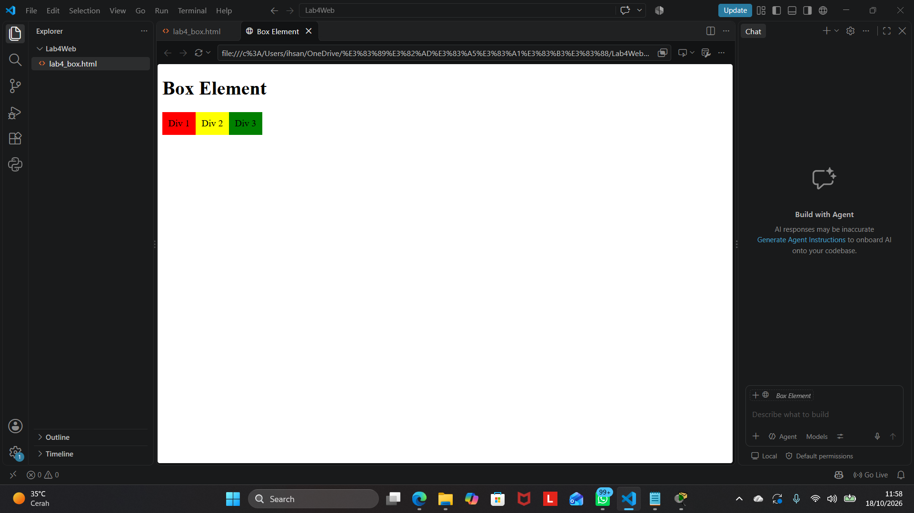

2. Menerapkan CSS Float Property
Menggunakan properti float untuk mengatur posisi elemen div agar dapat ditampilkan berdampingan.
Screenshot hasil:

3. Mengatur Clearfix Element
Menambahkan elemen berikutnya dan menggunakan properti clear untuk mengatur posisi elemen setelah elemen yang menggunakan float.
Screenshot hasil:
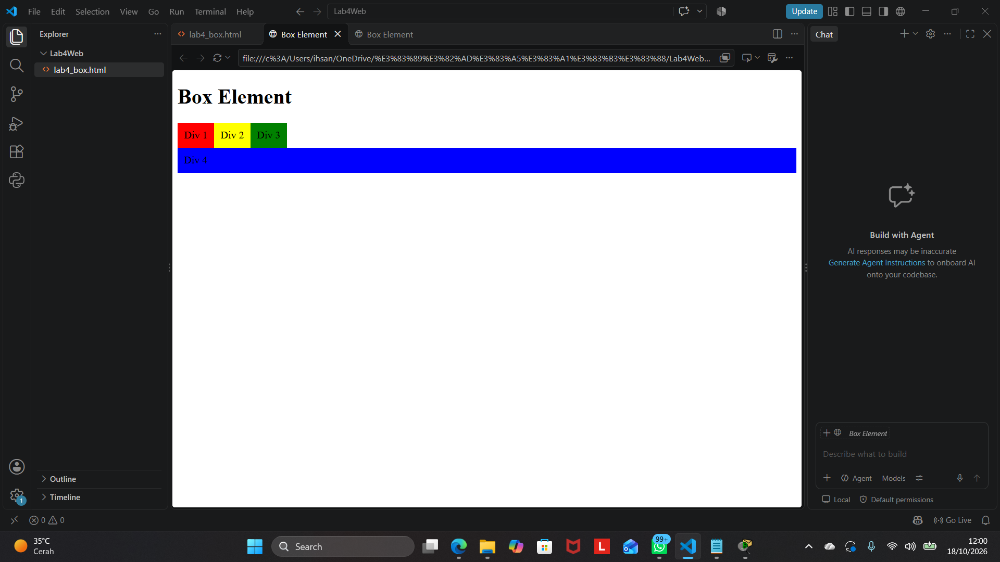

4. Membuat Kerangka Layout Sederhana
Membuat folder lab4_layout dan file home.html serta style.css. Kerangka layout menggunakan elemen HTML semantik seperti header, nav, section, aside, dan footer.
Screenshot hasil:
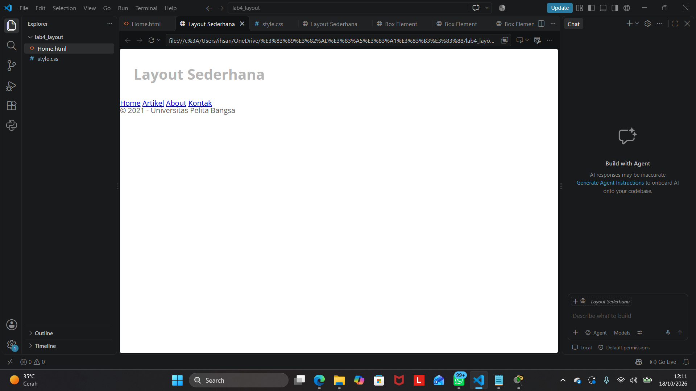

5. Mengatur Header
Menambahkan CSS untuk mengatur jarak, ukuran, dan warna teks pada bagian header.
Screenshot hasil:

6. Membuat Navigasi
Membuat menu navigasi untuk halaman Home, Artikel, About, dan Kontak. Warna menu juga diatur menggunakan CSS.
Screenshot hasil:
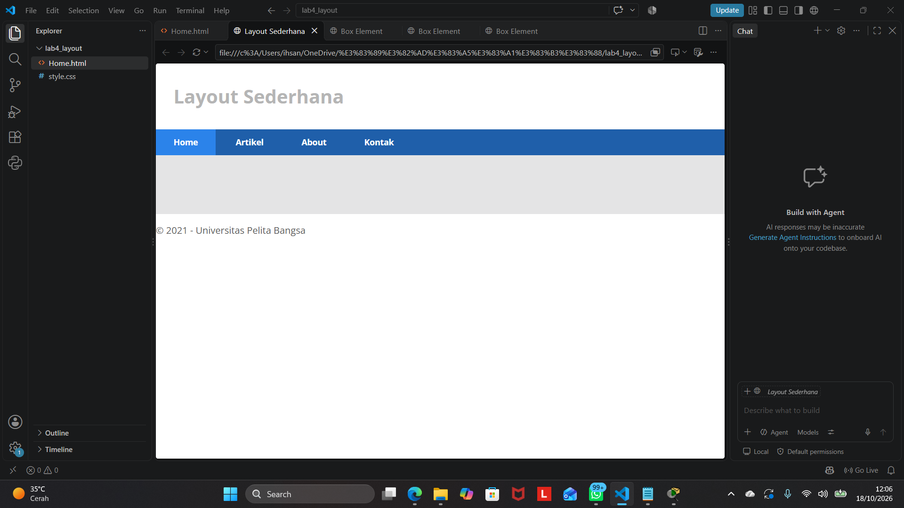

7. Membuat Hero Panel
Menambahkan bagian hero panel yang berisi judul, deskripsi singkat, dan tautan atau tombol.
Screenshot hasil:
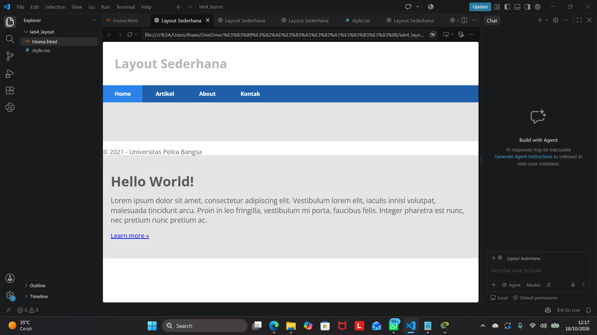

8. Mengatur Main Content dan Sidebar
Mengatur area konten utama dan sidebar menggunakan CSS sesuai layout pada modul.
Screenshot hasil:
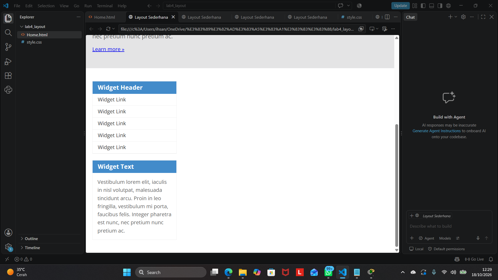

9. Membuat Sidebar Widget
Menambahkan widget pada sidebar, termasuk judul widget, daftar tautan, dan teks informasi.
Screenshot hasil:

10. Mengatur Footer
Menambahkan CSS pada footer untuk mengatur warna latar belakang, padding, dan warna teks.
Screenshot hasil:
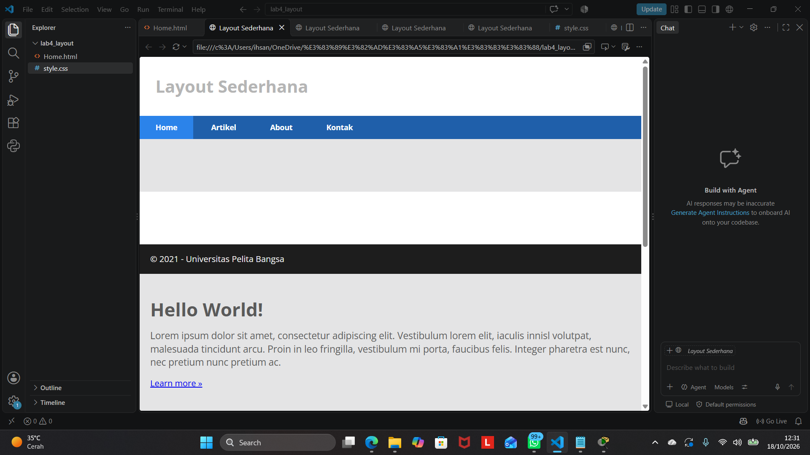

11. Menambahkan Elemen pada Main Content
Menambahkan beberapa elemen konten ke bagian utama, seperti gambar, judul, deskripsi, dan tombol detail.
Screenshot hasil:
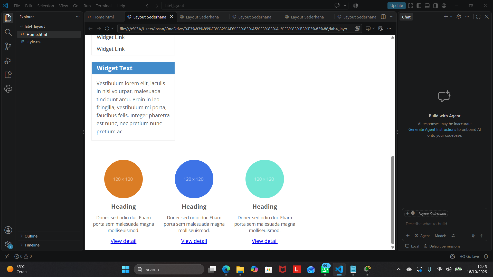

12. Menambahkan Content Artikel
Menambahkan artikel menggunakan elemen article, judul, gambar, dan paragraf. Posisi gambar diatur menggunakan CSS.
Screenshot hasil:
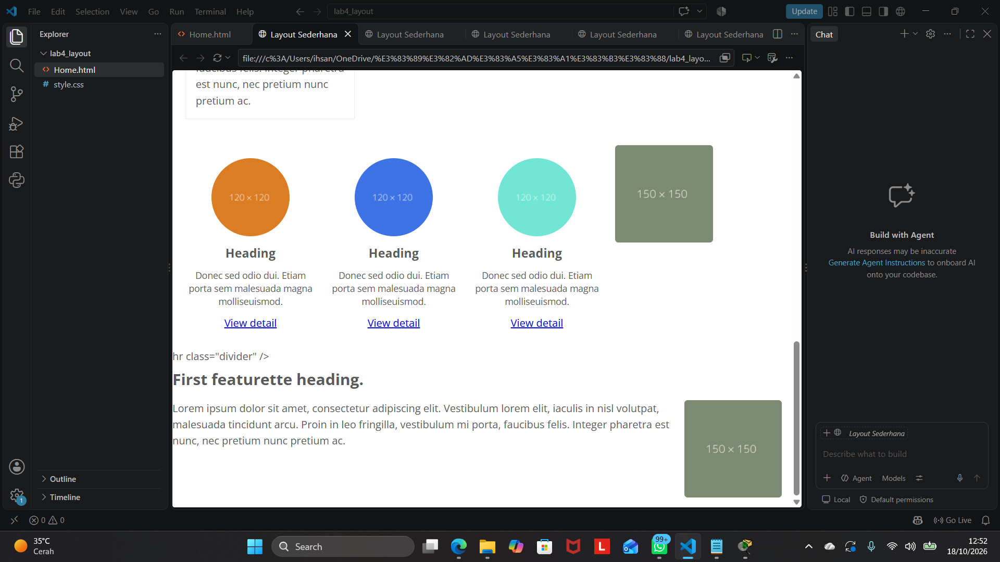

13. Membuat Halaman About
Membuat file about.html dengan satu layout yang berisi deskripsi diri, keahlian, dan portofolio.
Screenshot hasil:
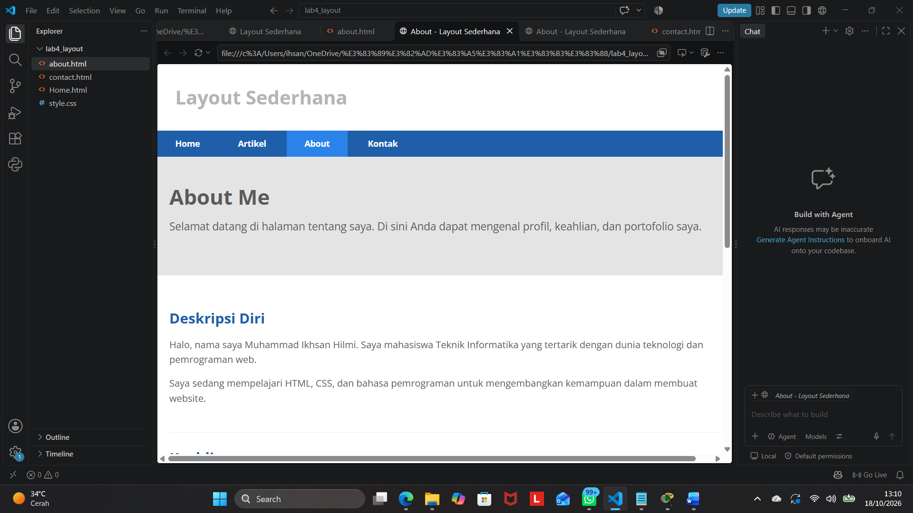

14. Membuat Halaman Contact
Membuat file contact.html yang berisi formulir kontak, meliputi nama, email, nomor telepon, subjek, dan pesan.
Screenshot hasil:
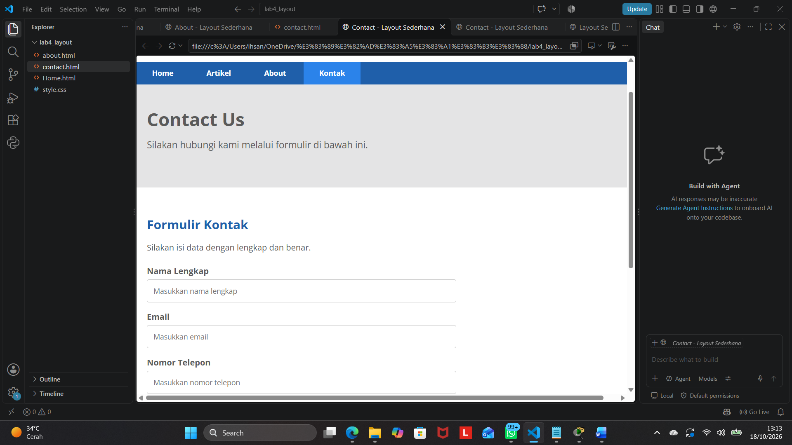

Kesimpulan
Pada Praktikum 4, saya mempelajari pembuatan layout web menggunakan HTML dan CSS, konsep box element, CSS float dan clear, serta penggunaan elemen HTML semantik. Saya juga membuat layout sederhana yang terdiri dari header, navigasi, hero panel, konten utama, sidebar, dan footer. Sebagai tugas, saya menambahkan halaman About yang berisi deskripsi dan portofolio serta halaman Contact yang berisi formulir.